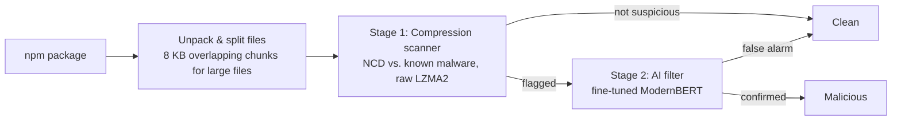

# PackGuard

**Lightweight two-stage detection of malicious npm packages using compression similarity and a small AI filter.**

> ⚠️ **Research project in progress** (ISEF, Computer Science & Software). Results, interfaces and settings may change between versions. No results are reported here until evaluation is complete.

---

## Why PackGuard?

npm is the backbone of modern web development: nearly every website, web app and JavaScript tool is built from packages downloaded through it. Attackers regularly slip malicious packages into the registry, and a single bad package can spread into thousands of projects.

Existing detectors force a trade-off:

- **Rule-based scanners** are lightweight but miss disguised (obfuscated) malware.
- **Machine-learning detectors** catch more but need powerful hardware and constant retraining.

PackGuard tests whether we can have both: accurate detection that runs on an ordinary computer.

## How it works



**Stage 1 – Compression scanner (C).** Malicious code tends to share hidden patterns with known malware, even when disguised. PackGuard measures this with **Normalized Compression Distance (NCD)**: two files that compress much better *together* than *separately* are similar.

```
NCD(x, y) = (C(xy) − min(C(x), C(y))) / max(C(x), C(y))
```

Values near 0 mean very similar; near 1 means unrelated. Each package is scored by its most suspicious file or chunk, with a threshold tuned to catch ~99% of malware.

**Stage 2 – AI false-alarm filter (Python → ONNX).** A pretrained, code-aware model (ModernBERT) reviews **only** the packages flagged by stage 1. A hierarchical design lets it read whole packages, guided by the suspicious regions found in stage 1. The trained model is exported to ONNX, quantized to 8-bit and runs on a standard CPU through the ONNX Runtime C API, inside the same C scanner.

## Repository structure

```
PackGuard/
├── src/                        # C scanner (stage 1; stage 2 ONNX inference planned)
│   ├── main.c                  # Command line: load references once, scan each package
│   ├── scanner.c / .h          # Reference set, cached C(x), parallel NCD scoring
│   ├── compresser.c / .h       # Raw LZMA2 compressed sizes via liblzma
│   ├── chunker.c / .h          # Per-file split into 8 KB overlapping chunks
│   ├── report.c / .h           # JSON output per package
│   ├── platform.c / .h         # Threads, directory walk, clock (POSIX and Win32)
│   ├── packguard.manifest      # Windows: UTF-8 code page, long paths
│   └── ai_filter.c / .h        # Stage 2 inference (ONNX Runtime C API), planned
├── training/
│   └── finetune_packguard.py   # Stage 2 fine-tuning (Hugging Face), planned
├── data/v1/malware_js_*.zip    # v1 malware set, 16 encrypted zips, see dataset_index.md
├── tests/                      # Test inputs and outputs, one folder per function
├── experiments/                # Configs and result logs per version
├── docs/                       # Design notes (memory safety and ownership)
├── scripts/build-windows.ps1   # Native Windows build (zig + static liblzma)
├── Makefile                    # Linux/macOS build
├── Dockerfile                  # Containerised scanner build
└── README.md
```

## Requirements

| Component | Version |
|---|---|
| C compiler | C17: GCC 11+ or Clang 14+ |
| GNU Make | 4.x |
| Windows native build | zig 0.16+, CMake 3.20+, GNU Make (e.g. `winget install zig.zig Kitware.CMake ezwinports.make`) |
| liblzma (xz) | 5.4.x or a recent 5.8.x — **never 5.6.0 or 5.6.1** (CVE-2024-3094 backdoor) |
| ONNX Runtime | 1.20+ (C API, prebuilt release) |
| Python | 3.10+ |
| Python packages | `transformers`, `datasets`, `torch`, `scikit-learn`, `pandas`, `optimum` |
| GPU | Only for training (e.g. free Google Colab T4). Detection runs on CPU. |

## Getting started

### 1. Install a C toolchain and liblzma

```bash
# Linux (Debian/Ubuntu)
sudo apt install build-essential pkg-config liblzma-dev
# macOS
xcode-select --install
brew install xz pkg-config
```

On Windows, either use WSL and follow the Linux commands, or build natively (step 3b).

Check the installed liblzma version is not 5.6.0 or 5.6.1:

```bash
xz --version
```

### 2. Install ONNX Runtime (C API)

Download the prebuilt package for your platform from <https://github.com/microsoft/onnxruntime/releases> (e.g. `onnxruntime-linux-x64-<version>.tgz`) and extract it, e.g. to `/opt/onnxruntime`. On macOS, `brew install onnxruntime` also works.

### 3. Build the scanner

```bash
make ONNXRUNTIME_ROOT=/opt/onnxruntime   # produces build/packguard
make clean                               # removes build output
```

For a single self-contained binary, link liblzma statically (`liblzma.a`); it is small and has no further dependencies. The Makefile already does this.

### 3b. Or build natively on Windows

```powershell
.\scripts\build-windows.ps1          # produces build\packguard.exe
.\scripts\build-windows.ps1 -Clean   # rebuilds liblzma too
```

The script downloads the xz 5.8.3 source, checks its pinned SHA-256 (the release is signed by Lasse Collin, key `3690 C240 CE51 B467 0D30 AD1C 38EE 757D 6918 4620`), builds a static liblzma with zig and links a single `packguard.exe` that uses Win32 threads on every logical processor. It gives byte-identical reports to the Linux build. Malware must still be handled only inside WSL, so on Windows scan only benign code.

### 4. Or build with Docker

```bash
docker build -t packguard .
docker run --rm --network none -v "$PWD/refs:/refs:ro" -v "$PWD/samples:/work:ro" packguard /refs /work/<package>
```

`--network none` and read-only mounts keep samples isolated.

### Run a scan

```bash
build/packguard [-j threads] [-t threshold] [-k groups] [-o report.json | -d report_dir] \
                <reference_dir> <package_path>...
```

| Option | Meaning |
|---|---|
| `-j` | Worker threads (default: all logical processors) |
| `-t` | Add `threshold` and `flagged` (score at or below the threshold) to the report |
| `-k` | Per chunk, also list the `k` closest reference groups (first folder below `reference_dir`, the code-shape folder in v1) |
| `-o` | Write the report of a single package to a file (default: stdout) |
| `-d` | Write one report per package to `report_dir/<package folder>.json` |

The references are loaded and their C(x) cached once, then every package is scanned in turn, so many packages per run is much faster than one run per package. Byte-identical reference chunks are scored once: v1 has 190,939 chunks but only 69,249 distinct ones, and this never changes a score. Exit status is 0 on success, 1 if any package failed and 2 for a usage error.

### 5. Train the AI filter

```bash
pip install -r training/requirements.txt
python training/finetune_packguard.py
```

## Scanner output format

The scanner writes one JSON file per package, which stage 2 reads:

```json
{
  "package": "example-pkg",
  "version": "1.0.2",
  "score": 0.41,
  "threshold": 0.5,
  "flagged": true,
  "seconds": 2.31,
  "chunks": [
    { "file": "install.js", "start": 0, "ncd": 0.41,
      "match": { "file": "1a2b3c4d5e6f/evil@1.0.0/index.js", "start": 0 },
      "near": [ { "group": "1a2b3c4d5e6f", "ncd": 0.41 } ],
      "text": "..." }
  ]
}
```

Lower `ncd` = more similar to known malware. `match` is the closest reference chunk. `threshold` and `flagged` appear only with `-t`, and `near` only with `-k`. `score` is `null` when a package has no JavaScript. `text` is the chunk as UTF-8, with bytes that are not valid UTF-8 written as U+FFFD.

## Default configuration (v1)

| Setting | Value |
|---|---|
| Comparison unit | Per file; files > 16 KB split into 8 KB chunks with 4 KB overlap |
| Compressor | Raw LZMA2 (liblzma), preset 6 (extreme off), 1 MB dictionary, `lc = 3` |
| C(xy) | Estimated as C(x) + C(y\|x), with the reference x as an LZMA preset dictionary |
| Package score | Most suspicious file/chunk (minimum NCD) |
| Stage 1 threshold | Tuned for ~99% malware recall on validation data |
| Stage 2 model | ModernBERT-base, fine-tuned, 8-bit quantized ONNX |

## Datasets

The v1 malware set is in `data/v1/malware_js_0.zip` to `malware_js_f.zip` (encrypted, password `infected`): 5,904 npm packages from the DataDog dataset, stripped to plain `.js` files with no `package.json`. See [`dataset_index.md`](dataset_index.md) for how it was built. Sources used:

- [DataDog malicious software packages dataset](https://github.com/DataDog/malicious-software-packages-dataset)
- Backstabber's Knife Collection (Ohm et al., 2020)
- MalwareBench (access on request)
- [OpenSSF malicious-packages](https://github.com/ossf/malicious-packages) (used to confirm live-scan detections)

Benign packages are downloaded from the public npm registry. Near-duplicates are removed and data is **split by publication date** to simulate detecting unseen attacks.

## Evaluation

- **Metrics:** precision, recall, F1, false alarm rate, processing time, memory use
- **Baseline:** GuardDog, evaluated on the same test data
- **Experiments:** compressor (xz vs. zstd vs. PPMd), chunk size (4 / 8 / 16 KB), with vs. without the AI filter
- **Live test:** 30-day scan of newly published npm packages, confirmed via npm security takedowns and OpenSSF reports

## ⚠️ Safety

This project handles **real, active malware**.

- Never run `npm install` on any sample.
- `data/` holds live malware in encrypted zips (password `infected`): extract them only inside WSL or a virtual machine, and never commit the extracted files.
- Keep other samples in their encrypted archives until needed; extract only inside a virtual machine.
- Malware is read strictly as text; PackGuard never executes package code.
- Suspicious live-scan findings are reported responsibly to npm's security team.

## Team

| Member | Role |
|---|---|
| Mayar | AI filter (Python): fine-tuning, evaluation, graphs |
| Fahad | Compression scanner (C): NCD engine, liblzma integration, live scan |

## License

_To be decided._ Third-party components: liblzma (public domain / 0BSD), ModernBERT (Apache 2.0), ONNX Runtime (MIT).
